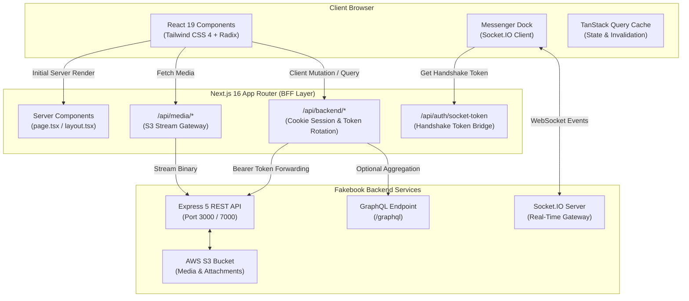

# Fakebook — Modern Social Networking Frontend

[](https://nextjs.org/)
[](https://react.dev/)
[](https://www.typescriptlang.org/)
[](https://tailwindcss.com/)
[](https://tanstack.com/query)
[](https://socket.io/)
[](https://www.radix-ui.com/)

A high-performance, accessible, and responsive social media frontend built with **Next.js 16 (App Router with Turbopack)**, **React 19**, and **Tailwind CSS 4**. Designed with a dual-theme aesthetic—featuring a **Facebook-inspired light mode** and an **X/Twitter-inspired dark mode**—Fakebook delivers a full-featured social networking experience with a floating Messenger dock, real-time presence and notifications, granular post reactions, and server-side data composition.

> **Backend Service:** Powered by the companion [Fakebook Core API & Real-Time Engine](https://github.com/Mostafa3lyan/s11-social-app.git).

---

## Table of Contents

- [Overview](#overview)
- [Key Features](#key-features)
- [Architecture & Design Patterns](#architecture--design-patterns)
  - [Server Component Enforcement](#server-component-enforcement)
  - [Backend-for-Frontend (BFF) Proxy & Security](#backend-for-frontend-bff-proxy--security)
  - [Media Streaming Gateway](#media-streaming-gateway)
  - [Real-Time Socket.IO Integration](#real-time-socketio-integration)
  - [Data Fetching & Cache Synchronization](#data-fetching--cache-synchronization)
- [Technology Stack](#technology-stack)
- [Project Structure](#project-structure)
- [Getting Started](#getting-started)
  - [Prerequisites](#prerequisites)
  - [Installation](#installation)
  - [Environment Configuration](#environment-configuration)
  - [Running Development Server](#running-development-server)
  - [Building for Production](#building-for-production)
  - [Verification & Code Quality](#verification--code-quality)
- [Screenshots & Visual Preview](#screenshots--visual-preview)
- [Backend Integration Guide](#backend-integration-guide)
- [Roadmap](#roadmap)
- [License](#license)

---

## Overview

Fakebook is designed to model the engineering standards of modern social web applications. It addresses key architectural challenges in social networks:

1. **Hydration & Render Performance:** Enforcing React Server Components (RSC) across all route entry points eliminates client-side waterfall requests for initial page loads while streaming dynamic content.
2. **Secure Session Isolation:** Session tokens are stored in `HttpOnly`, `SameSite` browser cookies. The client-side code never has direct access to raw JWTs; instead, an internal Next.js BFF proxy transparently handles bearer token attachment and refresh rotation.
3. **Multi-Window Real-Time Messenger:** A floating desktop dock supporting up to 3 concurrent live chat windows, automatic overflow minimization into stacked badges, synthesized Web Audio chimes, typing indicators, and message requests filtering.
4. **Adaptive Aesthetic:** A cohesive dual-theme design system combining the clarity of classic social feeds with modern high-contrast dark surfaces.

---

## Key Features

### 1. Authentication & Security
- **Multi-Method Login:** Supports standard email/password authentication and Google OAuth 2.0 integration.
- **Two-Factor Authentication (2FA):** Optional OTP-based two-factor verification during sign-in.
- **Email Verification & Magic Links:** Multi-step signup flow with 6-digit OTP verification and email-based password reset with secure magic links.
- **Account Recovery & Deactivation:** 30-day soft-deactivation grace period allowing users to restore their accounts seamlessly upon login.

### 2. Social News Feed & Posts
- **Feed Stream:** Infinite chronological feed with cursor/page pagination and optimistic updates.
- **Rich Post Composer:** Text creation with multi-image S3 file uploads, location tagging, and friend tagging.
- **Granular Reactions:** 7 distinct reaction types (`Like`, `Love`, `Care`, `Haha`, `Wow`, `Sad`, `Angry`) with dynamic breakdown tooltips and real-time counter updates.
- **Shared Posts:** Reshare posts to personal timelines with original post attribution and graceful handling of deleted source content.
- **Privacy Scopes:** Configurable post visibility (`Public`, `Friends`, `Only Me`).
- **Post Management:** Inline editing with `(edited)` indicators, soft deletion, and permanent deletion.

### 3. Hierarchical Comments & Discussions
- **Threaded Replies:** Structured discussion threads supporting parent comments and nested child replies.
- **Media Comments:** Attach images directly inside comments and replies.
- **Independent Reactions:** Full 7-reaction support for comments and replies.
- **Author Controls:** Author-only comment editing and deletion with cascading reply counts.

### 4. Floating Real-Time Messenger Dock
- **Multi-Window Interface:** Persistent floating Messenger dock rendering up to 3 simultaneous chat windows side-by-side.
- **Overflow Bubble Stack:** Automatically collapses older chat windows into a minimized circular avatar bubble stack with unread counters.
- **Direct & Group Chats:** 1-on-1 private messaging and multi-participant group chats with administrator controls (member management, rename, disband).
- **Message Requests Filter:** Dedicated message request inbox isolating messages from non-friends until explicitly accepted or declined.
- **Real-Time Presence & Typing:** Live multi-tab connection tracking displaying online/offline status and debounced typing indicators.
- **Delivery & Read Receipts:** Visual message status progression: Sent (`✓`), Delivered (`✓✓`), and Read (`✓✓` colored).
- **Message Lifecycle:** Author-only message editing and dual-mode deletion: *Unsend for everyone* (tombstone) vs. *Remove for you* (local hide).
- **Audio Notifications:** Procedural Web Audio API sound chime on incoming messages with a global mute toggle.

### 5. Social Graph & Relationships
- **Friend Requests:** Send, accept, decline, and cancel pending friend requests.
- **Categorized Tabs:** Dedicated friends management dashboard with tabs for Current Friends, Received Requests, and Sent Requests.
- **Mutual Blocking Engine:** Block and unblock users with instant UI enforcement preventing interaction across feeds, profiles, and messenger.

### 6. Notifications & Web Push
- **Live In-App Notifications:** Real-time bell dropdown with unread badge counter, pagination, and one-click "Mark all as read".
- **Firebase Cloud Messaging (FCM):** Service worker integration (`firebase-messaging-sw.js`) for native browser push notifications when running in the background.

### 7. Profiles & Account Management
- **Public & Private Profiles:** Public user timeline with visitor tracking, bio, friends dialog, and relationship status actions.
- **Profile Customization:** Direct-to-S3 pre-signed upload pipeline for profile avatars and panoramic cover banners.
- **Account Settings:** Edit personal information, change password with previous-password reuse prevention, manage blocked users, and trigger account deactivation.

---

## Architecture & Design Patterns



### Server Component Enforcement
Every `page.tsx` and `layout.tsx` file in the repository is strictly implemented as a **React Server Component** (`"use client"` is never declared on route entry points). 
- Initial data requirements, metadata generation, and auth-gate redirects execute entirely on the server.
- Interactive controls, dropdowns, composers, and forms are isolated into focused, leaf-level Client Components.
- Composition patterns (such as passing server-rendered content via `children`) prevent unnecessary client bundle expansion.

### Backend-for-Frontend (BFF) Proxy & Security
The frontend does not expose internal JWT tokens to client JavaScript or localStorage.
- The route handler at `app/api/backend/[...path]/route.ts` captures incoming requests from client components.
- It extracts the `ACCESS_TOKEN_COOKIE` from the secure HttpOnly cookie jar, attaches it to the upstream `Authorization: Bearer <token>` header, and forwards the request to the backend.
- When an upstream endpoint returns a `401 Unauthorized`, the proxy automatically invokes `/user/rotate-token` with the `REFRESH_TOKEN_COOKIE`, updates the cookies in the response, and retries the original request transparently.

### Media Streaming Gateway
To protect private cloud assets, image URLs returned by the backend are routed through the local media proxy at `app/api/media/[...key]/route.ts`. The proxy authenticates the request and pipes the asset stream directly from the backend S3 proxy, ensuring private attachments are never exposed via unauthenticated public URLs.

### Real-Time Socket.IO Integration
Real-time state is orchestrated through `components/providers/socket-provider.tsx`:
- The client exchanges its HttpOnly session for a short-lived single-use ticket via `/api/auth/socket-token`.
- The socket connects with this ticket and automatically joins the authenticated user's private channel (`user:${userId}`).
- Incoming real-time events (`chat:new_message`, `chat:message_delivered`, `chat:typing`, `notification:received`) trigger scoped TanStack Query cache invalidations or direct optimistic updates.

### Data Fetching & Cache Synchronization
- **TanStack React Query v5** manages server state caching, pagination cursors, and background refetching.
- Optimistic mutations are applied to posts, reactions, comments, and chat messages with automatic rollback upon network failure.
- A lightweight typed GraphQL client utility (`lib/api/graphql.ts`) enables querying `/graphql` without introducing heavy GraphQL runtime client packages.

---

## Technology Stack

| Category | Technology | Version | Purpose |
| :--- | :--- | :--- | :--- |
| **Framework** | Next.js | `16.4.3` | App Router, Server Components, Turbopack engine |
| **Library** | React / React DOM | `19.3.0` | UI rendering, concurrency, and client hooks |
| **Language** | TypeScript | `^5` | Strict static typing across all components & services |
| **Styling** | Tailwind CSS | `^4` | High-performance CSS-first utility styling |
| **UI Primitives** | Radix UI | `^1.8.1` | Headless, fully accessible UI components |
| **Component Kit** | shadcn/ui | `^4.22.1` | Tailored accessible component designs |
| **State & Query** | TanStack React Query | `^5.104.4` | Server state management, caching, and hydration |
| **Real-Time** | Socket.IO Client | `^4.8.4` | WebSocket client for messenger & notifications |
| **Web Push** | Firebase SDK | `^13.2.0` | Firebase Cloud Messaging (FCM) web push notifications |
| **Forms** | React Hook Form | `^7.90.0` | Performant form state handling |
| **Validation** | Zod | `^4.6.7` | Type-safe schema validation |
| **Theming** | next-themes | `^0.4.6` | Facebook Light and Twitter Dark theme switcher |
| **Notifications** | Sonner | `^2.0.8` | Toast notification system |
| **Icons** | Lucide React | `^1.59.0` | Scalable UI iconography |
| **Code Quality** | ESLint & Prettier | `^9` / `^3.9` | Automated linting and Tailwind class formatting |

---

## Project Structure

```
fakebook-app-fe/
├── app/                                 # Next.js App Router (100% Server Component routes)
│   ├── (auth)/                          # Authentication route group
│   │   ├── login/                       # Sign in page & 2FA modal
│   │   ├── signup/                      # Registration page
│   │   ├── confirm-signup-email/        # Post-signup OTP verification
│   │   ├── verify-otp/                  # Generic OTP verification
│   │   ├── forgot-password/             # Password reset request
│   │   ├── reset-password/              # Magic link / token password update
│   │   ├── restore-account/             # Deactivated account restoration
│   │   └── layout.tsx                   # Auth layout wrapper (Server Component)
│   ├── (main)/                          # Authenticated application route group
│   │   ├── page.tsx                     # Main news feed route (Server Component)
│   │   ├── friends/                     # Social graph & friend management
│   │   ├── notifications/               # In-app notifications feed
│   │   ├── profile/                     # Authenticated user's profile
│   │   │   └── [userId]/                # Dynamic public user profile
│   │   ├── settings/                    # Account, security & blocked users settings
│   │   └── layout.tsx                   # Main navigation & shell layout (Server Component)
│   ├── api/                             # Internal BFF Route Handlers
│   │   ├── auth/socket-token/           # Socket.IO handshake ticket bridge
│   │   ├── backend/[...path]/           # Upstream REST API proxy with token rotation
│   │   └── media/[...key]/              # Private S3 media streaming gateway
│   ├── layout.tsx                       # Root HTML & provider shell
│   ├── error.tsx                        # Global error boundary
│   └── not-found.tsx                    # Accessible 404 page
├── components/                          # React UI Components
│   ├── chat/                            # Real-time Messenger dock & floating windows
│   │   ├── chat-provider.tsx            # Global chat state & Web Audio manager
│   │   ├── floating-chat-window.tsx     # Draggable / resizable chat window
│   │   ├── message-list.tsx             # Infinite scrolling message stream
│   │   ├── message-bubble.tsx           # Message bubble with receipts & unsend actions
│   │   ├── message-composer.tsx         # Auto-expanding composer with attachments
│   │   └── messenger-dropdown.tsx       # Header quick-access messenger popover
│   ├── comments/                        # Comment lists, items, and reply composer
│   ├── layout/                          # Header, sidebar, mobile navigation
│   ├── notifications/                   # Notification item cards & view container
│   ├── posts/                           # Post card, reaction popover, post composer
│   ├── providers/                       # Theme, QueryClient, and Socket providers
│   ├── shared/                          # Reusable dialogs, cards, and state views
│   └── ui/                              # Radix UI / shadcn/ui primitives
├── hooks/                               # Custom React Query & interaction hooks
│   ├── auth/                            # Auth mutation hooks (login, signup, 2FA)
│   ├── chat/                            # useConversations, useMessages, useSendMessage
│   ├── comments/                        # useComments, useReplies, useCreateComment
│   ├── friends/                         # useFriends, useFriendRequests, useRelationship
│   ├── notifications/                   # useNotifications, useUnreadCount
│   └── posts/                           # usePosts, useCreatePost, useReactions
├── lib/                                 # Shared utilities & configurations
│   ├── api/                             # Fetch client (`client.ts`) & GraphQL helper
│   ├── schemas/                         # Zod validation schemas
│   ├── types/                           # Strongly typed TypeScript interfaces
│   └── utils.ts                         # Class merging and string helpers
├── public/                              # Static public assets
│   ├── facebook.png                     # Application branding icon
│   └── firebase-messaging-sw.js         # FCM background web push service worker
└── services/                            # Domain API service definitions
    ├── auth.service.ts                  # Auth endpoint bindings
    ├── conversation.service.ts          # Messenger conversation endpoints
    ├── friend.service.ts                # Friend management endpoints
    ├── message.service.ts               # Messenger message endpoints
    ├── notification.service.ts          # In-app & FCM notification endpoints
    ├── post.service.ts                  # Post CRUD & reaction endpoints
    ├── post.graphql.ts                  # Optional GraphQL post queries
    └── user.service.ts                  # User profile, blocked list, and settings
```

---

## Getting Started

### Prerequisites
- **Node.js**: Version `20.x` or later (LTS recommended)
- **Package Manager**: `npm` (v10+), `pnpm`, or `yarn`
- **Backend Service**: Running instance of the [Fakebook Backend](https://github.com/Mostafa3lyan/s11-social-app.git)

### Installation
Clone the repository and install project dependencies:

```bash
git clone https://github.com/Mostafa3lyan/fakebook-social-app-nextjs.git
cd fakebook-social-app-nextjs
npm install
```

### Environment Configuration
Create a local environment configuration file:

```bash
cp .env.example .env.local
```

Configure your local settings according to the following reference:

| Variable Name | Required | Default Value | Description |
| :--- | :---: | :--- | :--- |
| `BACKEND_URL` | **Yes** | `http://localhost:3000` | Target URL of the backend Express server (proxied by BFF). |
| `PORT` | No | `5173` | Local development server port. |
| `NEXT_PUBLIC_GOOGLE_CLIENT_ID` | No | *(Empty string)* | Google OAuth Web Client ID for Google Sign-In button. |
| `NEXT_PUBLIC_FIREBASE_API_KEY` | No | *(Empty string)* | Firebase Web Push API key for browser notifications. |
| `NEXT_PUBLIC_FIREBASE_AUTH_DOMAIN` | No | *(Sanitized domain)* | Firebase project authentication domain. |
| `NEXT_PUBLIC_FIREBASE_PROJECT_ID` | No | *(Sanitized project ID)* | Firebase project identifier. |
| `NEXT_PUBLIC_FIREBASE_STORAGE_BUCKET` | No | *(Sanitized bucket)* | Firebase storage bucket. |
| `NEXT_PUBLIC_FIREBASE_MESSAGING_SENDER_ID` | No | *(Empty string)* | Firebase Cloud Messaging sender ID. |
| `NEXT_PUBLIC_FIREBASE_APP_ID` | No | *(Empty string)* | Firebase application ID. |
| `NEXT_PUBLIC_FIREBASE_VAPID_KEY` | No | *(Empty string)* | Web Push VAPID public key for FCM registration. |

> [!NOTE]
> All credentials and sensitive API keys must be kept private. Do not commit `.env.local` to version control.

### Running Development Server
Start the Next.js development server with Turbopack:

```bash
npm run dev
```

Open [http://localhost:5173](http://localhost:5173) in your browser to view the application.

### Building for Production
Create an optimized production build and run it:

```bash
# Compile and package for production
npm run build

# Start production server
npm run start
```

### Verification & Code Quality
Verify type safety, linting compliance, and run the automated test suite:

```bash
# Run unit and component test suite
npm test

# Run tests in interactive watch mode
npm run test:watch

# Run TypeScript compilation check
npm run typecheck

# Run ESLint validation
npm run lint

# Format code with Prettier and Tailwind plugin
npm run format
```

#### Verified Test Suite Results:
- **`tests/unit/api-errors.test.ts`**: Verifies API error mapping, exception formatting, and status code handling (3 tests passed).
- **`tests/unit/date-utils.test.ts`**: Verifies relative time formatting, message timestamp grouping, and edge cases (5 tests passed).
- **`tests/components/chat-shell.test.tsx`**: Verifies Messenger dock mounting, window limit management, and bubble stacking (4 tests passed).
- **`tests/components/messenger-nav-button.test.tsx`**: Verifies header badge rendering, unread indicators, and popover triggers (3 tests passed).
- **`tests/components/message-bubble.test.tsx`**: Verifies delivery receipts (`✓`/`✓✓`), sender alignments, and action popovers (6 tests passed).
- **Total:** **21 passing tests across 5 test suites (0 failed).**

---

## Screenshots & Visual Preview

*Screenshots will be added following public asset curation.*

### Recommended Visual Previews:
1. **News Feed (Light Theme):** Facebook-inspired clean layout with post composer, rich reactions tooltip, and media attachments.
2. **Real-Time Messenger Dock (Dark Theme):** Side-by-side floating chat windows with active typing indicators, delivery receipts, and minimized bubble stack.
3. **Public Profile & Timeline:** Cover photo banner, avatar customization dialog, relationship action button, and personal post history.
4. **Friends & Requests Management:** Tabbed interface displaying pending incoming requests, sent requests, and mutual friend listings.

---

## Backend Integration Guide

The frontend communicates with the backend across three dedicated channels:

1. **REST Operations (Primary):** All standard state mutations (posting, commenting, reacting, friend actions, and profile updates) route through `/api/backend/*`. Responses adhere to a standardized envelope:
   ```json
   {
     "success": true,
     "message": "Operation completed successfully",
     "data": { ... }
   }
   ```
2. **GraphQL Queries (Selective):** For complex queries (e.g., fetching feed posts with author profiles and reaction breakdowns in a single query), the frontend provides lightweight GraphQL helpers via `services/post.graphql.ts` that execute against the backend `/graphql` endpoint.
3. **WebSocket Gateway:** Real-time bi-directional events (chat messaging, receipt updates, typing indicators, and user presence) are handled via Socket.IO:
   - Handshake authenticated via short-lived token generated from the BFF proxy.
   - Channel isolation ensuring users only receive messages for conversations in which they are verified participants.

---

## Roadmap

- [ ] **WebRTC Calling:** 1-on-1 voice and video calling integrated directly into the Messenger dock.
- [ ] **Rich Text & Markdown Editor:** Support for formatted post text, code snippets, and link card previews.
- [ ] **Stories / Ephemeral Content:** 24-hour disappearing media stories reel at the top of the feed.
- [ ] **Granular Notification Preferences:** User-configurable notifications matrix for mentions, reactions, and friend activity.

---

## License

This project is proprietary and private. All rights reserved. Check package settings for distribution details.